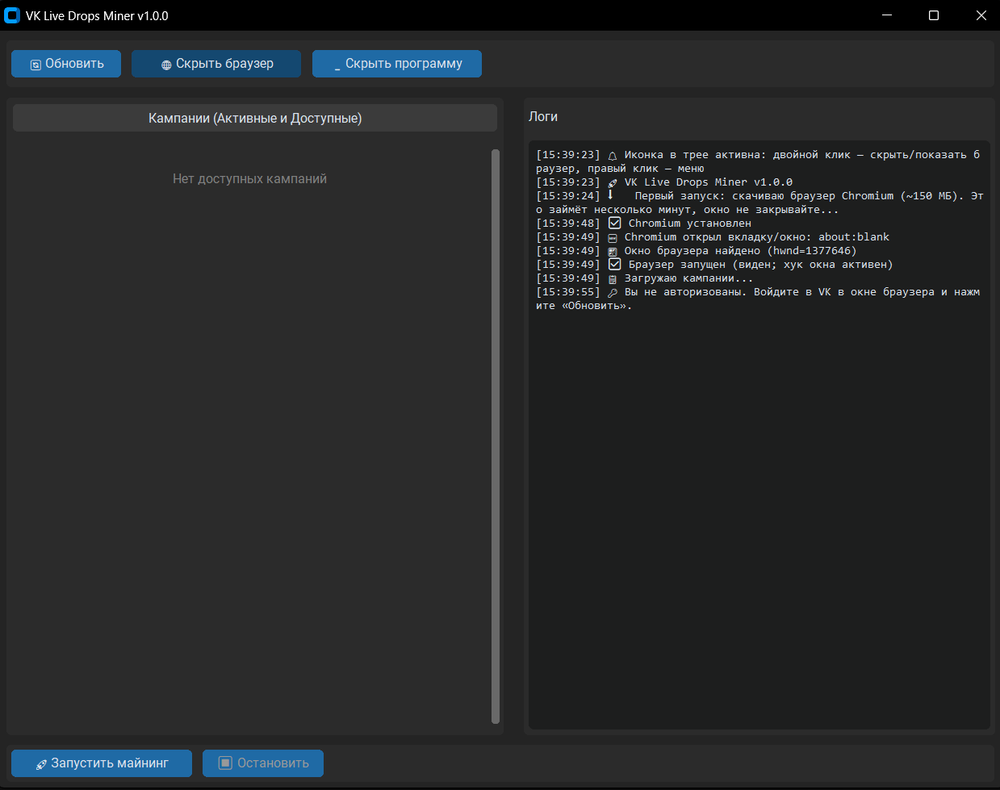

# VK Live Drops Miner

Программа для Windows, которая автоматически собирает дропы (боксы) на [live.vkvideo.ru](https://live.vkvideo.ru):
выбирает кампании, запускает стримы, ждёт 100 % прогресса, сама нажимает «Получить» и переходит к следующей награде.

> **English:** a Windows desktop app (CustomTkinter + Playwright) that watches live streams in a hidden
> browser and claims VK Live drops automatically. Download the latest `VKDropsMiner-…-win64.zip` from
> [Releases](../../releases), unzip, run `VKDropsMiner.exe`, log in to VK once.



## Возможности

- Кампании из разделов **«Активные»** и **«Доступные»**, очередь из нескольких кампаний
- **Автосбор наград**: при 100 % нажимает на бокс → «Получить» → «Понятно», затем проверяет, есть ли ещё награды, и продолжает
- **Браузер в фоне**: кнопка «Скрыть браузер» — окна не видно, не мигает, нет кнопки на панели задач; возврат в один клик или из трея
- **Режим без окна** (`headless`) — браузера нет вообще
- Если стример не в эфире — за ~4 секунды определяется и сразу пробуется другой стрим
- Иконка в трее (скрыть/показать браузер и программу), уведомление о каждой награде
- Живой прогресс по кампаниям, логи, сохранение сессии VK

## Установка

### Вариант 1 — готовая программа (рекомендуется)

1. Скачайте `VKDropsMiner-…-win64.zip` со страницы [Releases](../../releases) и распакуйте в **любую папку с правом записи** (например `D:\VKDropsMiner`, не в `Program Files`).
2. Запустите `VKDropsMiner.exe`. При первом запуске программа скачает браузер Chromium (~150 МБ) — подождите несколько минут.
3. В открывшемся окне браузера **войдите в свой аккаунт VK** и нажмите «Обновить» в программе. Сессия сохранится.
4. Отметьте кампании → «Запустить майнинг» → «Скрыть браузер».

> Windows SmartScreen или антивирус могут ругаться на неподписанный exe — это типично для программ, собранных PyInstaller.
> Если не доверяете сборке, запустите из исходников (вариант 2) или соберите exe сами (`build_exe.bat`).

### Вариант 2 — из исходников

```bash
pip install -r requirements.txt
python -m playwright install chromium
python main.py
```
Нужен Python 3.9+.

## Настройки

При первом запуске рядом с программой создаётся `config.yaml` (шаблон: [`config.example.yaml`](config.example.yaml)).
Самое полезное:

| Параметр | Что делает |
|---|---|
| `browser.start_hidden` | браузер сразу запускается скрытым |
| `browser.headless` | браузера нет вообще (войти в VK нужно один раз при `false`) |
| `drops.check_interval_seconds` | как часто читать прогресс |
| `drops.offline_check_seconds` | через сколько секунд «стример не в эфире» пробовать другой стрим |
| `drops.max_start_attempts` | сколько неудачных запусков стрима подряд до пропуска кампании |
| `drops.preferred_games` / `blacklist_games` | приоритет и исключение игр |
| `gui.start_in_tray` | окно программы сразу уходит в трей |

## Как работает скрытие браузера

Пока включено «скрыто», окно нашего Chromium уводится за пределы экрана и скрывается, а хук Windows прячет любое
новое окно браузера сразу после его появления. Ваш обычный Chrome не затрагивается (окна ищутся по метке в
командной строке). Страница считает, что вкладка видима, поэтому стрим не встаёт на паузу.

## Если что-то не работает

- Не забирается награда → в папке `debug/` появятся `claim_*.html` и `.png`. Приложите их к issue (**предварительно убедитесь, что в них нет личных данных**).
- Подробный лог: `logs/miner.log`. `VK_MINER_DEBUG=1` — дамп страницы кампаний при каждом обновлении.
- Скрипт `tools/find_window.py` показывает все окна Windows (для диагностики скрытия).

## Безопасность

- `vk_auth.json` содержит **cookie вашей сессии VK**. Никому не отправляйте и не публикуйте этот файл. Он добавлен в `.gitignore`.
- Программа не отправляет данные никуда, кроме сайтов VK, и не требует пароль: вы входите сами в окне браузера.

## Отказ от ответственности

Неофициальный проект, не связан с VK. Автоматизация просмотра может нарушать правила сервиса и привести к
ограничениям аккаунта. Используйте на свой риск.

## Разработка

```bash
pip install -r requirements-dev.txt
python -m playwright install chromium
python -m pytest -q          # тесты работают на синтетических страницах, без доступа к VK
build_exe.bat                # сборка exe (Windows)
```

Релиз: поднимите `__version__` в `main.py`, затем `git tag v1.0.1 && git push origin v1.0.1` — GitHub Actions
соберёт и опубликует `VKDropsMiner-v1.0.1-win64.zip`.

## Лицензия

[MIT](LICENSE)
